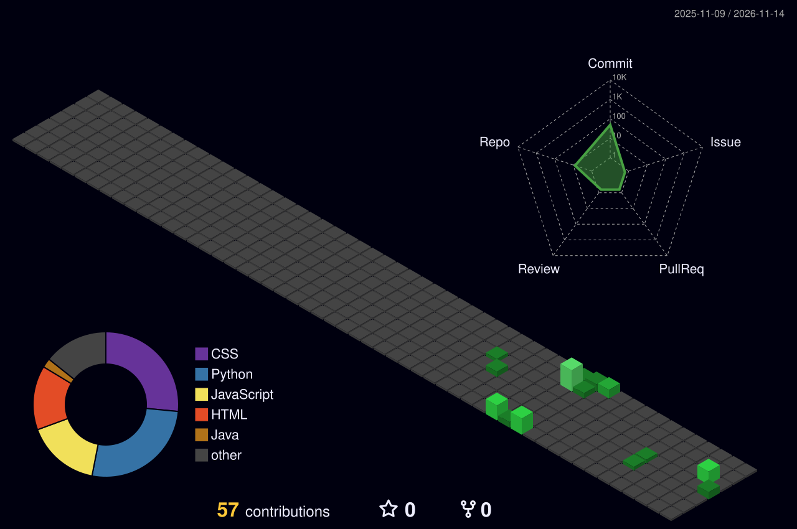

<div align="center">


<a href="https://git.io/typing-svg">
  
</a>

<br/>


</div>

---

## `> SYSTEM_PROFILE`

```text
IDENTITY   : Karthik Chinnapatla
GITHUB     : @Karthik-Chinnapatla
FOCUS      : Full-stack development • AI • Machine Learning
BUILDING   : Web applications and intelligent product experiences
MINDSET    : Learn. Build. Ship. Improve.
STATUS     : ONLINE
```

I enjoy building software across the stack, exploring AI/ML applications, and turning ideas into useful products. My public projects span MERN development, Java, Python-based deep learning, recommendation systems, and Verilog.

- ⚡ Interested in **full-stack engineering and AI-powered applications**
- 🧠 Exploring **LLMs, recommendation systems and intelligent agents**
- 🛠️ Focused on building practical projects and continuously expanding my engineering skills

---

## `> TECH_STACK`

<div align="center">

### LANGUAGES & WEB


### AI / DATA / DATABASE


### TOOLS


</div>

---

## `> FEATURED_BUILDS`

<table>
  <tr>
    <td width="50%" colspan="2">
      <h3>◈ Learning Management System</h3>
      MERN-based LMS with student registration, course enrollment, learning content, live classes, quizzes and progress tracking.
      <br/><br/>
      <a href="https://github.com/Karthik-Chinnapatla/Learning_Management_System--LMS-">View repository ↗</a>
    </td>
  </tr>
  <tr>
    <td width="50%">
      <h3>◈ Suspicious Activity Detection Using Deep Learning</h3>
      Deep-learning project focused on detecting suspicious activity.
      <br/><br/>
      <a href="https://github.com/Karthik-Chinnapatla/Suspicious_Activity_Detection_Using_Deep_Learning">View repository ↗</a>
    </td>
    <td width="50%">
      <h3>◈ Product Management System</h3>
      Java-based product management project.
      <br/><br/>
      <a href="https://github.com/Karthik-Chinnapatla/Product-Management-System">View repository ↗</a>
    </td>
  </tr>
</table>

<div align="center">
<a href="https://github.com/Karthik-Chinnapatla?tab=repositories">
  
</a>
</div>

---

## `> GITHUB_TELEMETRY`

<div align="center">


</div>

---

## `> CONTRIBUTION_MATRIX`

<div align="center">

<!-- Generated daily by .github/workflows/snake.yml -->


<!-- Generated daily by .github/workflows/3d-contrib.yml -->


</div>

---

## `> CONNECT`

<div align="center">

<a href="https://github.com/Karthik-Chinnapatla"></a>

<!-- Add Karthik's LinkedIn URL, portfolio URL and public contact email here if desired. -->

```text
[ CONNECTION ESTABLISHED ]
Thanks for visiting my profile.
Let's build something meaningful.
```


</div>
